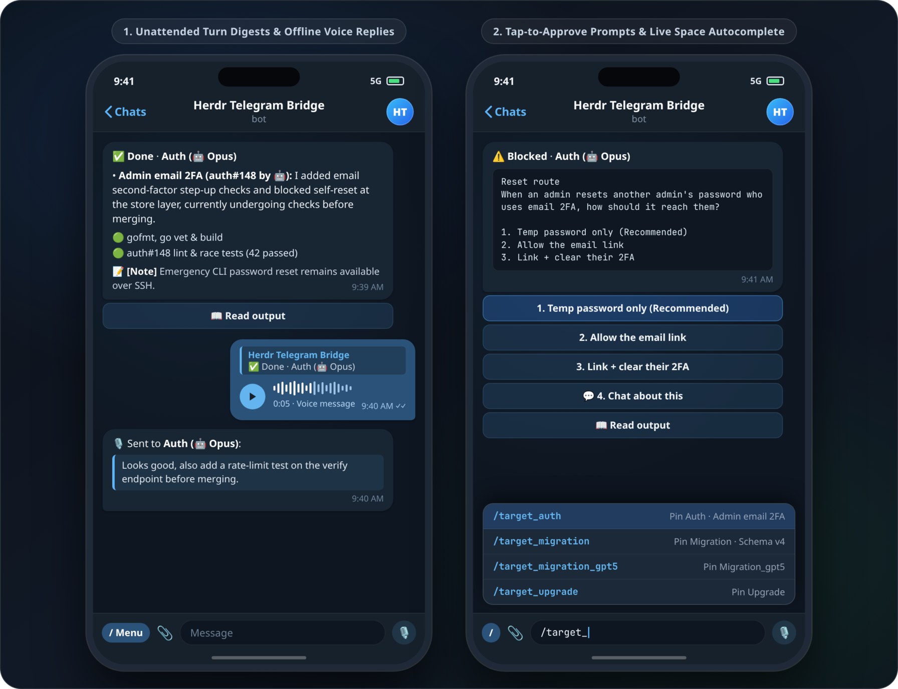

# herdr-telegram

[](https://github.com/jzhao234/herdr-telegram/actions/workflows/ci.yml)
[](LICENSE)
[](pyproject.toml)
[](install.sh)
[](pyproject.toml)

Modular two-way Telegram bridge and Tailscale mobile preview toolkit for [Herdr](https://github.com/herdrdev/herdr) terminal coding agents (`claude`, `codex`, `gemini`, `agy`, `opencode`, `cursor`, `pi`, `amp`, `droid`, and custom agent profiles).

Runs as a lightweight user daemon (`systemd --user` on Linux, `launchd` on macOS) using pure Python 3.11+ standard library (`tomllib` included, zero mandatory pip dependencies). When an agent finishes unattended or pauses on an approval dialog, `herdr-telegram` sends a clean mobile digest or tap-ready option buttons to your phone, and routes your swipe-replies, voice notes, or screenshots right back into that terminal pane. Every add-on (LLM summarization, local/cloud voice transcription, multi-bot routing, and Tailscale mobile previews) is optional and can be left off or disabled independently; point any coding agent at [AGENTS.md](AGENTS.md) to customize setup, routes, or code for your workflow.

---

## What It Looks Like on Your Phone

<p align="center">
  
</p>

- **Debounced turn digests & tap-to-approve prompts:** Waits for quiet (`90s` default, instant on direct replies), suppresses background `/cowork` helper completions, and turns multi-option `Blocked` dialogs into TOCTOU-guarded tap buttons.
- **Contextual swipe-replies & Telegram Quote Reply:** Swipe-replying to the latest card sends a clean prompt; scrolling up to reply to an older card or highlighting a sentence via Telegram's **Quote Reply** automatically attaches that message or excerpt as context.
- **Live space-named `/` menus & inline pickers:** Autocompletes `/target_<space>` (and `/target_<space>_<model>` for review panes) directly inside Telegram's `/` popup, plus one-tap button pickers for `/target`, `/read`, `/key`, and `/spawn`.
- **Two-way screenshots & opt-in voice notes:** Exchange PNG/JPEG/WebP/GIF images (`telegram-send --photo` and `.herdr-telegram/media`), and optionally enable free offline `faster-whisper` (`0 MB` idle RAM) or cloud voice-note transcription.
- **Multi-bot TOML routing & Tailscale mobile previews:** Route workspaces across `1..N` user-named Telegram bots in `config.toml`, and expose `localhost` dev servers to your phone in one command with `ts-preview <port> --telegram`.

---

## One-Line Install (Linux & macOS)

Requires Linux (`systemd --user`) or macOS (`launchd`), `python3` (>= 3.11), `git`, and [Herdr](https://github.com/herdrdev/herdr).

```bash
curl -fsSL https://raw.githubusercontent.com/jzhao234/herdr-telegram/main/install.sh | bash
```

Or install as a [Herdr plugin](https://herdr.dev/plugins/) (adds popup `setup` / `doctor` / `setup-voice` panes plus `Send Selected Text` and `Send Pane Snapshot` actions inside Herdr):

```bash
herdr plugin install jzhao234/herdr-telegram
herdr plugin pane open --plugin jzhao234.herdr-telegram --entrypoint setup
```

Or from a local clone (symlinks your checkout directly for easy hacking):

```bash
git clone https://github.com/jzhao234/herdr-telegram.git
cd herdr-telegram && ./install.sh
```

### 30-Second Interactive Pairing (`herdr-telegram setup`)

1. Message [`@BotFather`](https://t.me/BotFather) on Telegram with `/newbot` and copy your bot token.
2. Run the interactive onboarding wizard:
   ```bash
   herdr-telegram setup
   ```
   It prompts for your `@BotFather` token (hidden input), registers your bot's `/` command menu automatically, prints a one-time `https://t.me/<bot>?start=<code>` pairing link for your phone to capture your `TELEGRAM_CHAT_ID` securely, writes `~/.config/herdr-telegram/env` (`0600`), and starts the background service (`systemd --user` on Linux or `launchd` on macOS).
3. Run a full health check anytime:
   ```bash
   herdr-telegram doctor
   ```

<details>
<summary><b>Headless / manual setup, logs, CLI-only install (uv / pipx), and uninstall</b></summary>

- **Manual headless setup:** Add `TELEGRAM_BOT_TOKEN=<token>` to `~/.config/herdr-telegram/env`, start the service (`systemctl --user enable --now herdr-telegram.service` on Linux or `launchctl bootstrap gui/$(id -u) ~/Library/LaunchAgents/io.github.jzhao234.herdr-telegram.plist` on macOS), send `/start` to your bot to discover `TELEGRAM_CHAT_ID`, add it to `env`, and restart.
- **Inspecting service logs:** Run `journalctl --user -u herdr-telegram.service -f` on Linux or `tail -f ~/.local/state/herdr-telegram/bridge.log` on macOS.
- **Re-running updates:** Re-run the one-line install command anytime to pull updates cleanly without overwriting `~/.config/herdr-telegram/env` or `~/.config/herdr-telegram/config.toml`.
- **Uninstalling:** Run `~/.local/share/herdr-telegram/install.sh --uninstall` (or `curl -fsSL https://raw.githubusercontent.com/jzhao234/herdr-telegram/main/install.sh | bash -s -- --uninstall`) to stop the service and remove installed files while keeping `~/.config/herdr-telegram` (`--purge` removes bridge config and state files too).
- **Bundled coding-agent skill (`SKILL.md`):** Install [skills/herdr-telegram/SKILL.md](skills/herdr-telegram/SKILL.md) with `npx skills add jzhao234/herdr-telegram` (or `./install.sh --install-skill`) so Claude Code, Codex, and Gemini agents automatically know how to run `telegram-send`, attach `--photo` screenshots, read inbound `.herdr-telegram/media/` images, and share `ts-preview <port> --telegram` links.
- **Installing via `uv tool` or `pipx`:** `uv tool install git+https://github.com/jzhao234/herdr-telegram.git` installs the `herdr-telegram`, `telegram-send`, and `ts-preview` CLIs without registering an OS service (`install.sh` is recommended when you want automatic `systemd` / `launchd` service setup). Always install from this GitHub repository URL rather than bare `pip install telegram-send`, which is an unrelated legacy PyPI package.

</details>

---

## Modular Rules & Pluggable Agents (`config.toml`)

Out of the box, `~/.config/herdr-telegram/env` is all you need for a single-bot setup (`Herdr Telegram Bridge`). When you want multiple Telegram bots with your own channel names and titles, custom agent profiles, or per-workflow rules (for example an instant-delivery `alerts` bot with silent all-green sweeps alongside your `90s`-debounced `[defaults]` bot), copy [config.example.toml](config.example.toml) to `~/.config/herdr-telegram/config.toml`:

```toml
# Keep tokens private in ~/.config/herdr-telegram/env; reference env var names here.
# Name channels whatever you want; title defaults to "Herdr Bridge (<name>)" unless set.
[bots.alerts]
token_env = "TELEGRAM_ALERTS_BOT_TOKEN"
title = "Alerts Bot"

# Fallback policy ("the rest") when no [[routes]] rule matches
[defaults]
bot = "default"
idle_delay_seconds = 90
blocked_delay_seconds = 30
fast_track_replies = true
silent_when_green = false

# First matching [[routes]] entry wins (workspace, agent, name, or title globs)
[[routes]]
name = "alerts"
match_workspaces = ["alerts-*", "deploy-*", "incident-*"]
bot = "alerts"
idle_delay_seconds = 0
silent_when_green = true
summary_style = "- Keep deploy and health-sweep bullets under 20 words."

# Add custom /spawn aliases or TUI status-bar adapters for any Herdr agent
[agents.opus]
kind = "claude"
spawn_args = ["--model", "opus"]
default_model = "opus"

[agents.codex-mini]
kind = "codex"
spawn_args = ["--no-alt-screen", "-m", "o4-mini"]
default_model = "o4-mini"
```

- **All 22 Herdr agent kinds supported:** `/spawn --agent <name>` works out of the box with `claude`, `codex`, `gemini`, `agy`, `opencode`, `cursor`, `pi`, `amp`, `droid`, `cline`, `copilot`, `devin`, `grok`, `hermes`, `kilo`, `kimi`, `kiro`, `maki`, `mastracode`, `omp`, `qodercli`, and `qwen`, plus any `[agents.<alias>]` profile you define (`spawn_args`, `model_patterns`, `prompt_prefixes`, `footer_patterns`, `default_model`).
- **Ordered `[[routes]]` + `[defaults]`:** Route panes across `1..N` Telegram bots by `match_workspaces`, `match_agents`, `match_names`, or `match_titles` globs, with per-route `idle_delay_seconds`, `blocked_delay_seconds`, `fast_track_replies`, `silent_when_green`, `hold_on_short_timers`, `suppress_support_done`, `include_output`, `summary_provider`, `summary_model`, and `summary_style`.
- **Per-channel model handles:** Model handles (`🤖 Opus`, `🤖 Sonnet`, `🤖 GPT5`) are numbered independently per routed bot channel (`Opus1`, `Opus2` only when multiple lead panes share a model on the same bot, ignoring background `/cowork` helper panes).

---

## Adaptable Summarizer Backends

For longer completed turns (`> 180` characters), `TurnSummarizer` extracts only the latest turn (including promptless cron/timer wakeups), redacts secrets first, and distills outcomes, passed checks (`🟢`), findings (`🔴 [P1]`, `🟡 [P2]`, `📝 [Note]`), and open questions.

By default (`HERDR_SUMMARY_PROVIDER=auto`), it uses whichever CLI or API key you already have configured, or falls back to clean HTML with zero setup:

| `HERDR_SUMMARY_PROVIDER` | How it runs | Default model | Auth / Config |
| :--- | :--- | :--- | :--- |
| `auto` *(default)* | Probes `claude`, `codex`, `gemini`, `agy`, then env API keys, else `off` | Provider default | Zero config |
| `claude` | `claude -p --setting-sources project --no-session-persistence --strict-mcp-config --tools ""` via stdin in empty temp dir | `haiku` | Existing Claude Code login or `ANTHROPIC_API_KEY` |
| `codex` | `codex exec --ephemeral --sandbox read-only` via stdin in empty temp dir | Codex config default | Existing Codex login or `OPENAI_API_KEY` |
| `gemini` | `gemini --approval-mode plan --admin-policy <deny-all.toml> -e none` via stdin in empty temp dir | `gemini-2.5-flash` | Existing Gemini CLI login or `GEMINI_API_KEY` |
| `openai` | `POST /chat/completions` (`HERDR_SUMMARY_API_URL` supports OpenRouter/Groq/vLLM) | `gpt-4.1-mini` | `HERDR_SUMMARY_API_KEY` or `OPENAI_API_KEY` |
| `ollama` | Local HTTP `http://127.0.0.1:11434/v1/chat/completions` | `llama3.2` | Local `ollama serve` |
| `anthropic` | `POST https://api.anthropic.com/v1/messages` | `claude-haiku-4-5` | `HERDR_SUMMARY_API_KEY` or `ANTHROPIC_API_KEY` |
| `gemini-api` | `POST .../v1beta/models/<model>:generateContent` | `gemini-2.5-flash` | `HERDR_SUMMARY_API_KEY` or `GEMINI_API_KEY` |
| `agy` | `agy --sandbox` with all tool permissions denied in empty temp dir | `gemini-2.5-flash` | Existing Antigravity CLI |
| `off` | Disables LLM calls; formats terminal output directly as clean HTML | None | None |

You can also use `provider:model` shorthand directly in `HERDR_SUMMARY_MODEL` (such as `HERDR_SUMMARY_MODEL=claude:haiku` or `HERDR_SUMMARY_MODEL=ollama:qwen2.5:7b`) or override `summary_provider` / `summary_model` per route in `config.toml`.

---

## Optional Voice Notes (Offline Whisper or Cloud STT)

Voice note transcription is **completely optional** so the core install stays zero-dependency (`0` extra pip packages and `0 MB` RAM/disk when left unconfigured, and `herdr-telegram doctor` reports `[OK] voice: optional`).

To enable free, local, offline speech-to-text via [`faster-whisper`](https://github.com/SYSTRAN/faster-whisper) (`large-v3-turbo`, `int8`, Silero VAD):

```bash
herdr-telegram setup-voice
# Or choose a lighter model on low-RAM machines:
herdr-telegram setup-voice --model small.en
```

`setup-voice` provisions an isolated virtualenv in `~/.local/state/herdr-telegram/voice-venv` and runs `faster-whisper` **on demand** in a secret-scrubbed subprocess (`0 MB` idle daemon RAM), seeded with your live Herdr space names for accurate vocabulary recognition. Prefer a cloud STT API or turning voice off explicitly? Set `HERDR_VOICE_PROVIDER` in `~/.config/herdr-telegram/env` (or `voice_provider` in `config.toml`):

| `HERDR_VOICE_PROVIDER` | How it runs | Default model | Auth / Config |
| :--- | :--- | :--- | :--- |
| `auto` *(default)* | Uses local `voice-venv` if installed, else `HERDR_VOICE_API_KEY` / cloud env key, else dormant | Provider default | Zero config |
| `local` | Offline `faster-whisper` subprocess in `~/.local/state/herdr-telegram/voice-venv` | `large-v3-turbo` | `herdr-telegram setup-voice` (or `./install.sh --with-voice`) |
| `openai` | `POST /v1/audio/transcriptions` (`HERDR_VOICE_API_URL` override supported) | `gpt-4o-mini-transcribe` | `HERDR_VOICE_API_KEY` or `OPENAI_API_KEY` |
| `groq` | `POST https://api.groq.com/openai/v1/audio/transcriptions` | `whisper-large-v3-turbo` | `HERDR_VOICE_API_KEY` or `GROQ_API_KEY` |
| `gemini-api` | `POST .../v1beta/models/<model>:generateContent` | `gemini-2.5-flash` | `HERDR_VOICE_API_KEY` or `GEMINI_API_KEY` |
| `off` | Rejects voice notes with instructions to enable or keep disabled | None | None |

When you hold Telegram's 🎙️ mic button, `herdr-telegram` echoes a `<blockquote>🎙️ "..."</blockquote>` transcript receipt and routes via swipe-reply, your `/target` pin, a spoken space prefix (`"Upgrade, run the auth tests"`), or an instant one-tap space picker.

---

## Telegram Commands & Reply Routing

On startup, `herdr-telegram` automatically registers these commands in Telegram's native `/` menu picker across every configured bot:

| Action | Syntax | What it does |
| :--- | :--- | :--- |
| **Swipe-reply** | Swipe any alert or `telegram-send` card | Sends your reply, voice note, or photo straight to the bound pane (skips the idle wait, and automatically quotes the message if you reply to an older card or highlight an excerpt) |
| **Space / model prefix** | `upgrade: run the auth tests` | Routes text or a photo caption to the `Upgrade` lead agent (or `upgrade_opus:` / `migration_gpt5_1:` for review agents; `opus:` and `w12:p1:` also work) |
| **Send voice note** | Hold Telegram's 🎙️ mic button (or share `.ogg`/`.m4a`/`.mp3`/`.wav`) | Transcribes speech locally via `faster-whisper` (or cloud STT), routes via swipe-reply, pinned `/target`, spoken `"Upgrade, ..."` prefix, or a one-tap space picker, and echoes the transcript back |
| **Send photo / screenshot** | Attach photo, album, or PNG/JPEG/WebP/GIF file | Saves images inside `<workspace>/.herdr-telegram/media` (`0600`, auto-excluded from `git status`), coalesces multi-photo albums into a single prompt, and prompts the target agent to inspect them |
| **List spaces** | `/status` or `/status all` | Shows active spaces on this bot channel (or all channels) with one-tap `📖` read buttons |
| **Read space** | `/read [space]` | Opens a one-tap space picker (or reads `<space>` / `/read_<space>` directly) |
| **Pin target** | `/target [space\|clear]` | Opens a one-tap space picker with `🧹 Clear pin` (and syncs live `/target_<space>` items into Telegram's `/` popup) |
| **Send key** | `/key [space] [key]` | Opens an interactive inline keypad (`⏎ Enter`, `⎋ Esc`, `⇥ Tab`, `👍 y`, `👎 n`, `1..4`, `🛑 Ctrl+C`) or sends keys directly |
| **Spawn repo** | `/spawn [[-a <agent>] <repo> [prompt]]` | Opens a tap-to-spawn repo & agent picker across `HERDR_SPAWN_ROOTS`, or launches `<repo>` directly (also works as a photo caption!) |

> **Tip for crisp terminal or log screenshots:** Send PNG or JPEG screenshots via Telegram's **Send as File** option to avoid photo compression. On iPhone, standard Telegram Photos auto-convert to JPEG; raw `.heic` file attachments are rejected with a reminder to resend as a Photo or PNG/JPEG.

---

## CLI Helpers

### `herdr-telegram`: Setup, Diagnostics, and Daemon

```bash
# Interactive 30-second pairing wizard (@BotFather token + /start auto-discovery + service start)
herdr-telegram setup

# Optional: install free local offline faster-whisper (large-v3-turbo) for Telegram voice notes
herdr-telegram setup-voice

# Full diagnostic check (--json and --offline supported)
herdr-telegram doctor
```

### `telegram-send`: Proactive Agent Notifications & Photos

Agents (or CI/deploy scripts) can message you or send screenshots without ever reading your bot token:

```bash
# Uses $HERDR_PANE_ID automatically and routes via config.toml [[routes]]
telegram-send "Finished database migration; ready for smoke test?"

# Send a UI screenshot, chart, or diff image (swipe-replying to the photo routes back to the pane)
telegram-send --photo ./artifacts/login-mobile.png "Updated mobile layout; approve?"

# Force delivery through a specific named bot channel from config.toml (such as --bot alerts)
telegram-send --bot alerts "🟢 HTTP health (12/12 endpoints healthy)"
```

If you installed with a custom `HERDR_TELEGRAM_CONFIG_DIR`, export `HERDR_TELEGRAM_CONFIG_DIR` in your shell profile as well so `telegram-send` reads the same directory as the background service.

### `ts-preview`: Mobile Dev Server Previews over Tailscale

Expose any `localhost` port to your phone over your tailnet and push a clickable link to Telegram:

```bash
# Expose localhost:5173 and text the tailnet URL to Telegram
ts-preview 5173 --telegram

# Expose a specific path with a custom label
ts-preview http://localhost:8080/docs/ --label "API Docs" --telegram

# Inspect active routes or check Tailscale Serve readiness
ts-preview status
ts-preview doctor

# Tear down one port or reset all previews
ts-preview off 5173
ts-preview reset
```

---

## Security & Safety Design

- **Private 1:1 authorization & trust boundary:** Rejects group/supergroup/channel updates and ignores any user whose numeric ID does not match `TELEGRAM_CHAT_ID`. Because your paired Telegram account can prompt and spawn local coding agents, treat your Telegram account (enable Two-Step Verification) and `~/.config/herdr-telegram/env` (`chmod 600`) as part of your workstation trust boundary.
- **Automatic secret redaction:** Strips private keys, OpenAI/Anthropic/GitHub/Slack/Telegram/AWS tokens, JWTs, Bearer headers, URL passwords, and `*_SECRET`/`*_API_KEY` assignments before text or captions reach either an LLM summarizer or Telegram. Note that pixels inside screenshots sent via `telegram-send --photo` cannot be text-redacted, so avoid screenshotting raw secret values.
- **Verified image handling & workspace isolation:** Inbound Telegram photos are downloaded only after chat authorization, freshness, and target-pane resolution succeed, verified by magic bytes, written atomically (`0600`) inside `<workspace>/.herdr-telegram/media` (refusing symlinks and creating `.herdr-telegram/.gitignore` plus `.git/info/exclude` so screenshots stay hidden across worktrees and subfolders), and pruned automatically (`7d` / `50` files / `200 MB`). Outbound `telegram-send --photo` opens files with `O_NOFOLLOW`, verifies regular-file `fstat` and image magic bytes (`JPEG`/`PNG`/`WebP`/`GIF`), and automatically switches between `sendPhoto` and `sendDocument` for tall full-page screenshots (`> 10000px`).
- **Isolated summarization & redirect-blocked HTTP:** CLI summarizers run inside a fresh empty temporary directory with tools/MCP disabled, prompts piped via `stdin`, and `TELEGRAM_BOT_TOKEN` scrubbed from child environments. Remote HTTP summarizers enforce `https://` (`http://` is permitted strictly on `127.0.0.1` / `localhost` / `::1`) and refuse all HTTP redirects so API headers are never forwarded across origins.
- **TOCTOU-guarded callbacks:** Inline approval buttons encode `state_change_seq`, a `terminal_id` tag, and a dialog-context digest, re-verifying live Herdr state before sending keys so a delayed tap can never approve a different command.
- **Loopback-only previews:** `ts-preview` refuses non-loopback targets and checks pre/post Tailscale Serve snapshots so stopping or adding a route never downgrades existing HTTPS listeners or wipes sibling paths.

---

## Development & Agent-Guided Customization

Zero mandatory runtime dependencies (`voice` is an optional extra installed only if you run `herdr-telegram setup-voice`). See [AGENTS.md](AGENTS.md) for the full module map, configuration reference, modular on/off switches, and extension playbooks if you want to point Claude Code, Codex, Gemini, or Cursor at this repo to tailor it.

Run formatting, lint, shellcheck, and the unit test suite locally:

```bash
uvx ruff format --check . herdr-telegram telegram-send ts-preview
uvx ruff check . herdr-telegram telegram-send ts-preview
shellcheck install.sh
python3 -m unittest discover -s . -v
```

## License

[MIT](LICENSE)
